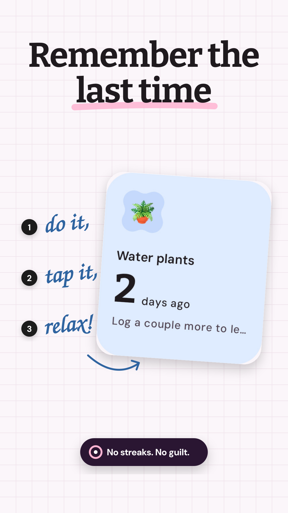
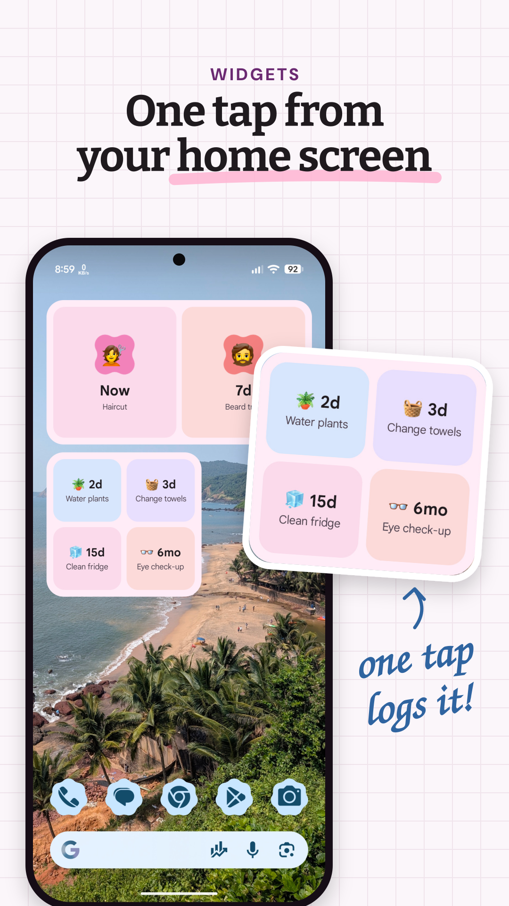
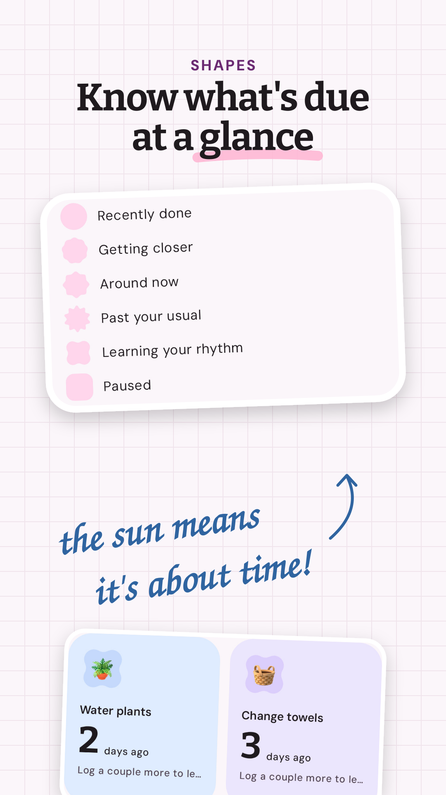
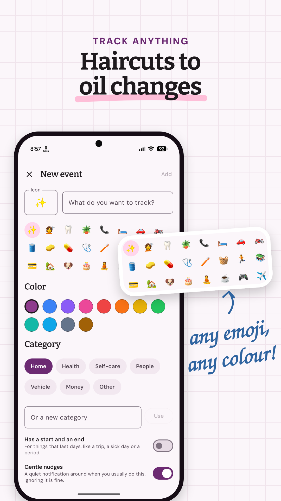
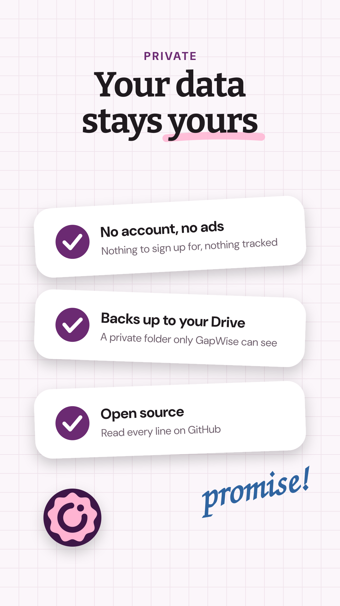

# GapWise

<p>
  
  
  
  
  
</p>

**Remember the last time. Know the next.**

GapWise tracks how long it's been since you last did the things that don't run on a fixed schedule: a haircut, an oil change, calling home, washing the bedsheets. It learns your usual rhythm and gives you a gentle nudge around when something is usually due. There are no streaks and no guilt.

## Features

- **One-tap logging.** Tap a tile to log it, with undo. Long-press or tap ⓘ to open the details.
- **Learned rhythm.** After 3 logs it estimates your usual gap (for example, "Usually every 36 days") and when the next one is expected. One-off long gaps, like a trip, are ignored.
- **Gentle nudges.** A notification arrives around when something is usually due. You can log straight from it, and ignoring it is fine.
- **Multi-day events.** Periods, trips and sick days have a start tap and an end tap. GapWise shows how long they usually last.
- **Insights.** Each event has a gap chart, a calendar and an editable history with notes. You can log a past day.
- **Organize.** Categories, pin, hide, pause, search, sorting (due soon, recent, name), and grid or list view.
- **Log from anywhere.** There's a home-screen widget (tap a row to log it) and launcher shortcuts for your top events.
- **Welcome tour.** Over 40 starter events, each seeded with an approximate last date.
- **Private.** No account, ads or tracking. JSON export and import for backups.

## Design

The app uses Material 3 Expressive. Each event's icon sits in a shape that shows where it is in its cycle: a circle when it's fresh, a scallop as it builds, a sun when it's around now, and a soft burst when it's past your usual. Logging morphs the shape back. Numbers are set in Bitter and the interface text in DM Sans. Both fonts are under the SIL Open Font License; see `licenses/`.

## Google Drive backup

Settings has **Back up now**, **Restore** (replaces everything on the phone) and an optional **Back up every day** (Wi-Fi only). Backups go to the hidden Drive *app data* folder (`drive.appdata` scope), so they don't clutter the user's Drive and only GapWise can read them.

Google needs to know the app before it can grant Drive access. One-time setup in [Google Cloud Console](https://console.cloud.google.com/):

1. Create (or pick) a project and **enable the Google Drive API**.
2. **OAuth consent screen**: set it up as *External*, add the `.../auth/drive.appdata` scope, and while in *Testing* add your Google account as a test user.
3. **Credentials → Create credentials → OAuth client ID → Android**:
   - Package name: `com.yogeshpaliyal.gapwise`
   - SHA-1: `3E:6A:14:8B:1D:1D:79:61:16:12:E6:55:8B:35:E4:1A:68:BE:A5:CE` (the committed `app/debug.keystore`, which also signs the latest-master APK)
   - Add another Android client with your release key's SHA-1 (or Play App Signing's) when you ship on Play.

No client ID goes into the code: Google matches the package name and signing certificate.

This is already configured in the Google Cloud project `gapwise-515217`: consent screen in Testing, `drive.appdata` scope, and Android clients for the debug key and the release upload key (SHA-1 `87:BA:2F:A9:26:DE:9F:D0:33:2A:93:74:B4:5C:1A:9A:69:31:69:78`). Play App Signing's SHA-1 still needs its own client once the app is on Play. Until this is done, Drive actions show a message pointing here.

## Store listing

The Play listing lives in `fastlane/metadata/android/en-US/` (title, descriptions, screenshots, feature graphic and icon). The art is generated from real screenshots in `docs/screenshots/` in the same style as Halo:

```
python3 docs/play_screenshots.py docs/screenshots fastlane/metadata/android/en-US/images/phoneScreenshots
python3 docs/play_assets.py docs/screenshots fastlane/metadata/android/en-US/images
for f in fastlane/metadata/android/en-US/images/{,phoneScreenshots/}*.svg; do rsvg-convert "$f" -o "${f%.svg}.png" && rm "$f"; done
```

Needs `rsvg-convert`, Pillow, and the Bitter, DM Sans and TeX Gyre Chorus fonts.

## Build

```
./gradlew :app:assembleDebug
```

Debug and CI builds are signed with the committed `app/debug.keystore` (standard debug passwords), so a new APK installs over the previous one.

Requires JDK 17 and the Android SDK (compileSdk 37, minSdk 26). The stack is Kotlin, Jetpack Compose with Material 3, Room, WorkManager and Glance.

## Flavors and updates

| Flavor | Where it ships | Update check |
|---|---|---|
| `github` | APK on GitHub | Release builds: newest GitHub Release (`vX.Y.Z`). Debug builds: the rolling `latest-master` pre-release. Updating opens the APK download. |
| `play` | Google Play | Play In-App Updates (flexible: downloads in the background, then "Restart now"). Rating uses Play In-App Review. |

**Releasing** works like Halo: open *Actions → Release → Run workflow* and pick patch, minor or major. The workflow checks the signing secrets, bumps `versionName`/`versionCode` in `app/build.gradle.kts`, runs the tests, builds the signed GitHub APK and Play AAB, verifies the signing certificate, then commits the bump and tag to `master` in one atomic push and publishes a GitHub Release with notes built from the commits (plus the certificate fingerprint and checksums). It then announces the release in GitHub Discussions, and on Telegram, Bluesky and Mastodon when their secrets are set. Play needs the bundle signed with your upload key (`SIGNING_*` secrets), and Drive backup needs another Android OAuth client with Play's app-signing SHA-1.

Debug builds install as **GapWise Debug** (`com.yogeshpaliyal.gapwise.debug`) next to the release and Play apps.

## Latest build

Every push to `master` that touches the app builds a GitHub-flavor debug APK and publishes it to the [`latest-master`](../../releases/tag/latest-master) release.
